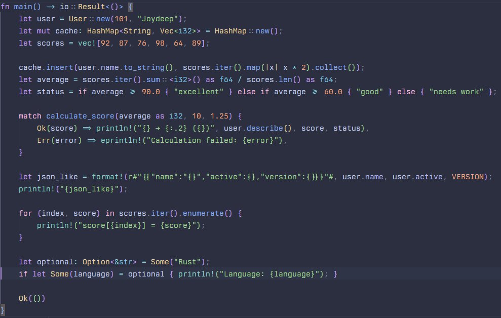

# OneNord for Zed

**A beautifully crafted, distraction-free dark theme for [Zed](https://zed.dev/).**

OneNord combines the cool, icy atmosphere of Nord with carefully balanced pastel syntax colors to create a clean, cohesive coding environment. Its deep blue-gray background, soft accents, and refined UI colors offer a comfortable visual experience for long coding sessions without sacrificing readability.

Designed for developers who appreciate minimalism, consistency, and thoughtful details.

## Previews

### Code Preview

Get a closer look at OneNord's carefully tuned syntax highlighting.



### Full IDE Preview

Experience the complete theme across the editor, sidebar, terminal, tabs, and other UI elements.


## Features

- **Deep, Soothing Dark Palette** — A rich blue-gray background (`#2B2F40`) creates a calm workspace with balanced contrast.
- **Pastel Syntax Highlighting** — Soft blues, mauves, greens, and peach tones distinguish code elements without overwhelming the interface.
- **Consistent UI Colors** — A cohesive palette across the sidebar, editor tabs, terminal, status bar, and other interface components.
- **Git & Diff Support** — Distinct colors for added, modified, and deleted lines make version-control changes easier to scan.
- **Distraction-Free Design** — A restrained color palette keeps the focus on your code while maintaining clear visual hierarchy.
- **Designed for Long Sessions** — Muted backgrounds and thoughtfully selected accents aim to provide a comfortable coding experience.

## Installation

### Install Locally (Development)

To install OneNord directly from its repository:

1. Clone or download this repository.
2. Open **Zed**.
3. Open the Extensions view.
4. Select **Install Dev Extension** or run `zed: install dev extension` from the Command Palette.
5. Choose the directory containing the OneNord extension.

Once installed, the theme will be available in Zed's theme selector.

## Usage

### Activate OneNord

Open the theme selector using:

- **Windows/Linux:** `Ctrl + K`, then `Ctrl + T`
- **macOS:** `Cmd + K`, then `Cmd + T`

Search for **OneNord** and select it to apply the theme.

### Set as Your Default Theme

You can also set OneNord as your default theme in Zed's `settings.json`.

Open Settings using `Ctrl + ,` on Windows/Linux or `Cmd + ,` on macOS, then add or update the following setting:

```json
{
  "theme": "OneNord"
}
```

## Color Philosophy

OneNord is built around a simple idea: **a dark interface should feel calm, not dull.**

| Element | Design Direction |
| --- | --- |
| Background | Deep blue-gray |
| Syntax | Soft, expressive pastels |
| Interface | Consistent and understated |
| Diff highlights | Clear, meaningful distinctions |
| Overall feel | Minimal, cool, and comfortable |

## Contributing

Feedback, suggestions, and contributions are welcome!

If you find a visual inconsistency, spot an issue, or have an idea for improving the theme, feel free to open an issue or submit a pull request.

## Feedback

Using OneNord? I'd love to hear what you think.

- Share your feedback and suggestions.
- Report bugs or color inconsistencies.
- Suggest improvements to syntax highlighting or UI colors.

## License

See the repository's `LICENSE` file for licensing information.

---

**OneNord for Zed** — *Cool tones. Clear code. Calm focus.*
