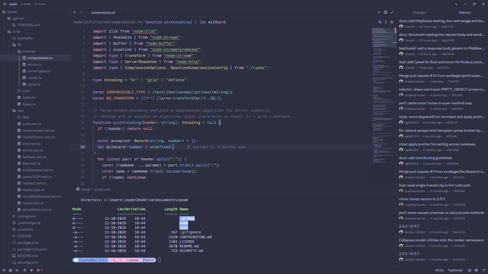

# OneNord for Zed

A beautifully crafted, distraction-free dark theme for the [Zed editor](https://zed.dev/). OneNord seamlessly blends the cool, icy aesthetics of Nord with vibrant, pastel syntax highlights to create a visually soothing environment designed for long coding sessions.


*(Note: Replace `screenshot.png` with a path to an actual screenshot of your theme in action)*

## Features

- **Soothing Dark Background:** Built on a deep blue-gray base (`#2B2F40`) that reduces eye strain while maintaining excellent contrast.
- **Vibrant Pastel Syntax:** Code comes to life with a carefully tuned array of pastel accents (blues, mauves, greens, and peaches) that make syntax parsing effortless without feeling harsh.
- **Cohesive UI:** Harmonious color tokens across the sidebar, terminal, status bar, and active editor tabs.
- **Git & Diff Awareness:** Clear, intuitive color coding for version control (added/modified/deleted) and inline diff highlights.

## Installation

### Method 1: Extension Registry (Recommended)

1. Open Zed and open the Extensions panel (`Cmd+Shift+X` on macOS or `Ctrl+Shift+X` on Windows/Linux).
2. Search for **OneNord**.
3. Click **Install**.

### Method 2: Local Installation

To install the theme locally for development or personal tweaking:

1. Clone this repository to your local machine.
2. Open Zed and open the extensions view.
3. Click on the **Install Dev Extension** button (or use the `zed: install dev extension` command via the command palette).
4. Select the directory where you cloned this repository.

## Usage

Once installed, you can switch to the theme by opening the theme selector (`Cmd+K Cmd+T` or `Ctrl+K Ctrl+T`) and selecting **OneNord**. 

Alternatively, you can set it directly in your Zed `settings.json` (`Cmd+,` or `Ctrl+,`):

```json
{
  "theme": "OneNord"
}